# Data model

Schema source: `src/db/schema/*.ts` (one file per domain). Migrations: `drizzle/`.
Everything a user can use is decided server-side by **`src/server/services/entitlements.ts`**.

## Relationships

```mermaid
erDiagram
  users ||--|| account_members : "belongs to exactly one account"
  accounts ||--|{ account_members : "has (1 owner + team)"
  users ||--o| accounts : "owns (host)"
  account_members ||--o{ member_permissions : "granted"
  accounts ||--o{ invitations : "sends"
  invitations ||--o{ invitation_permissions : "will grant"

  plans ||--o{ plan_apps : "includes"
  plans ||--o{ plan_prices : "priced at (Admin)"
  accounts ||--o{ subscriptions : "subscribes"
  plans ||--o{ subscriptions : ""
  plan_prices ||--o{ subscriptions : ""
  accounts ||--o{ payments : "pays"
  subscriptions ||--o{ payments : ""

  accounts ||--o{ app_installations : "built-in app state"
  accounts ||--o{ storage_objects : "stores"
  storage_objects ||--o{ storage_objects : "folder contains"

  users ||--o| developer_profiles : "applies as"
  developer_profiles ||--o{ appzone_items : "publishes"
  appzone_items ||--o{ appzone_item_versions : "versions"
  appzone_items ||--o| upload_fees : "listing fee"
  accounts ||--o{ purchases : "buys"
  appzone_items ||--o{ purchases : ""
  purchases ||--o| payments : "paid by"
  accounts ||--o{ appzone_acquisitions : "owns (permanent)"
  appzone_items ||--o{ appzone_acquisitions : ""
  purchases ||--o| appzone_acquisitions : ""
  accounts ||--o{ appzone_installations : "installed now"

  accounts ||--o{ conversations : ""
  conversations ||--o{ conversation_participants : ""
  conversations ||--o{ messages : ""
  users ||--o{ notifications : ""
  accounts ||--o{ support_tickets : ""
  conversations ||--o| support_tickets : "thread"
  accounts ||--o{ support_access_grants : ""
  support_access_grants ||--o{ support_access_grant_scopes : "least privilege"

  users ||--o{ sessions : ""
  users ||--o{ auth_tokens : ""
  users ||--o{ login_events : ""
```



`audit_logs` deliberately has **no foreign keys** so history survives deletions, and a trigger
rejects `UPDATE`, `DELETE` and `TRUNCATE`. `stripe_events` and `rate_limits` stand alone.

## Core rules

| Rule | Where it's enforced |
| --- | --- |
| Every user is in exactly one account; one owner per account | `account_members.user_id` unique; partial unique index on owner |
| A user's plan = their account's current subscription's plan, else Free | `planForAccount()`; `subscriptions_one_current_idx` allows one current subscription |
| `active`, `trialing`, `past_due` grant the plan; `incomplete`, `unpaid`, `canceled` don't | `ENTITLING_STATUSES` in `src/lib/entitlements.ts` |
| Team members share the host's plan, storage and apps | entitlements resolve via the account, never the user |
| Owners have every permission; members only those granted; billing, members, apps and permanent deletion are owner-only | `effectivePermissions()`, `assertPermission()`, `assertOwner()` |
| Storage quota (1/20/50/100 GB) | `reserveStorage()`: one conditional `UPDATE`, safe under concurrency; `accounts.storage_used_bytes >= 0` check |
| Team size (0/1/3/10), pending invitations count | `assertSeatAvailable()` locks the account row (`FOR UPDATE`) |
| Free: **10 free AppZone items, lifetime** | `acquireAppzoneItem()`; acquisitions are permanent (uninstall removes only `appzone_installations`), counted where `counts_toward_free_limit` |
| Paid plans: unlimited **free** items (not counted) | `decideAcquisition()` |
| Paid items: purchase required on every plan, never uses a free download | `decideAcquisition()`; `purchases_one_paid_idx` |
| 15% commission | `purchases_fee_is_15_percent`, `purchases_split_adds_up` checks; `splitSale()` |
| Upload fees: app $39.99, theme $29.99, widget $19.99 | `upload_fees_amount_matches_kind` check |
| Item price is free or at least $0.99 | `appzone_items_price_valid` |
| Plan limits match the spec | DB rows seeded by migration `0004`; test compares them with `PLAN_SPEC` |
| Prices are Admin-controlled with history | `plan_prices`: old prices deactivated, one active per plan+interval+currency |
| Stripe is the payment source of truth; webhooks idempotent | `stripe_events.id` primary key; `payments` must reference a Stripe object |
| Support access ≤ 24h, with reason and scopes | `support_access_max_24h`, `support_access_reason_length`, `support_access_grant_scopes` |
| Unique file/folder names per folder (case-insensitive); folders have no bytes | `storage_objects_unique_name_idx`, `storage_objects_kind_fields` |

## Decisions (owner-confirmed unless marked)

- Free download limit is **lifetime** (confirmed).
- AppZone has free and paid items; paid plans get unlimited **free** items; paid items are bought separately (confirmed).
- Free accounts can buy paid items; purchases don't use free downloads (assumed).
- Free items acquired while on Free count toward the limit even after upgrading and downgrading again; items acquired on a paid plan never count (assumed).
- `past_due` keeps access while Stripe retries payment (assumed; change `ENTITLING_STATUSES` to tighten).
- Accepting a team invitation when the person already has their own workspace is a Phase 3 decision (schema allows one account per person).

## Using it

```ts
import { getEntitlements, assertPermission, reserveStorage, acquireAppzoneItem } from "@/server/services/entitlements";

const ent = await getEntitlements(user);          // read: plan, limits, permissions, hasApp()
await assertPermission(user, "storage.upload");   // throws AppError FORBIDDEN
await reserveStorage(user, file.size);            // throws AppError PLAN_LIMIT when over quota
await acquireAppzoneItem(user, itemId);           // enforces lifetime limit, purchases, publishing
```

UI may use `getEntitlements()` to hide or disable things, but every change must go through a
service that calls these functions. Frontend checks are never the enforcement.
